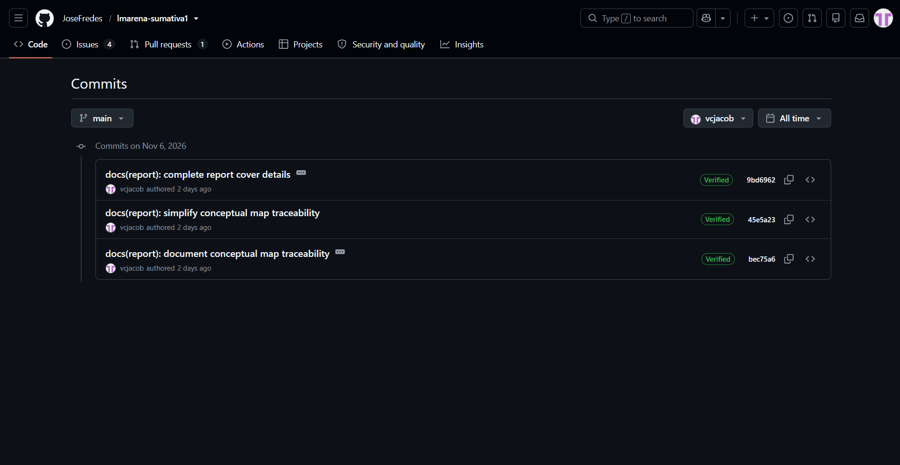
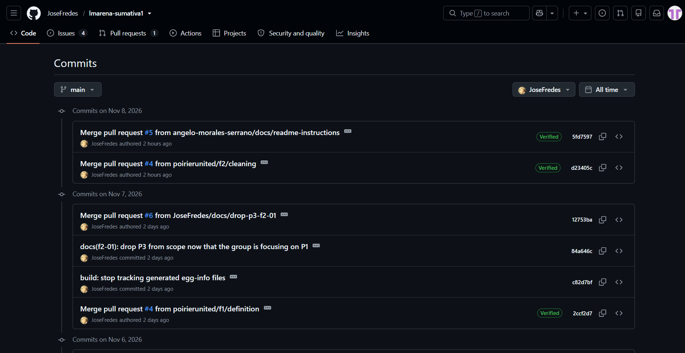
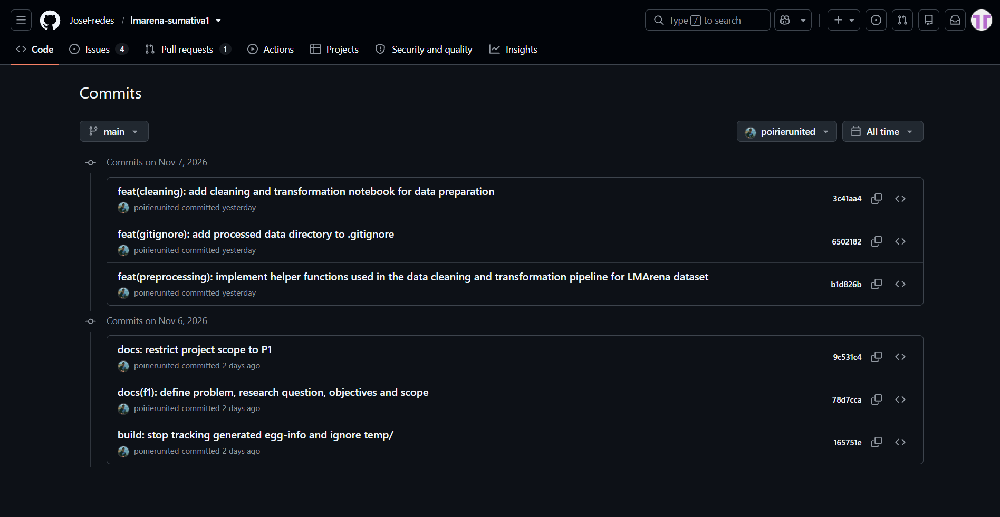
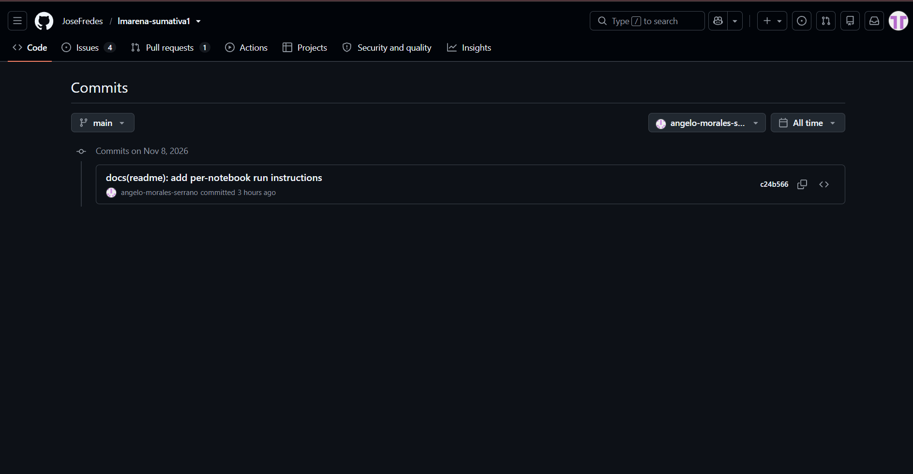
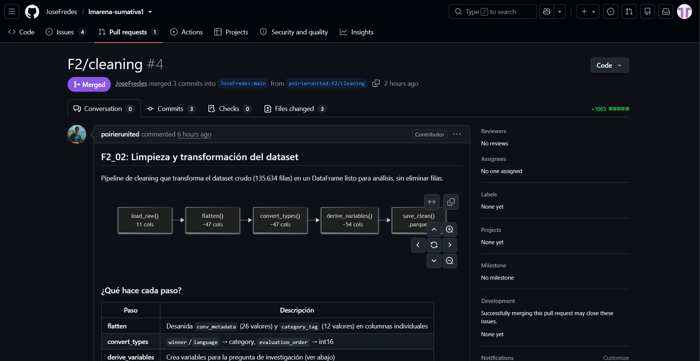
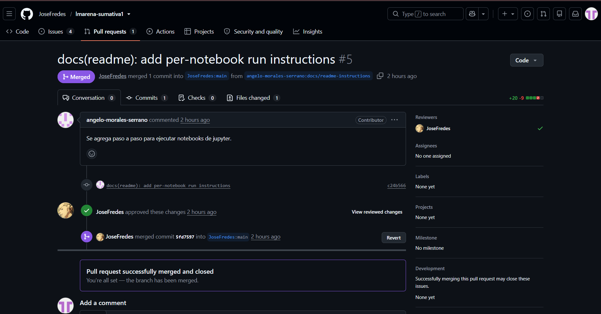
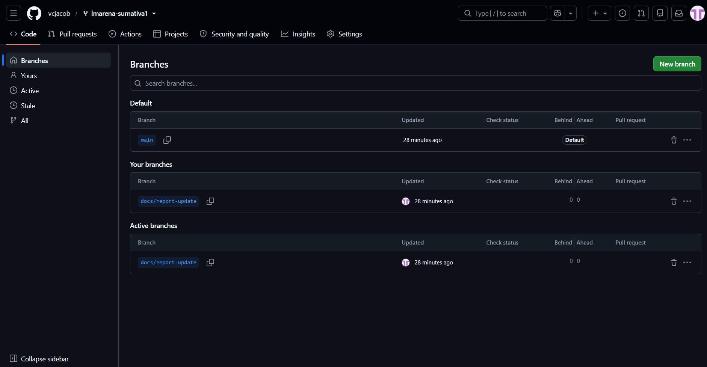

# Informe técnico · Avance del proyecto, Fases 1 y 2

---

## 1. Portada e índice

| Campo | Contenido |
|---|---|
| Curso y código | MCDI500 · Programación para la Ciencia de Datos (sección MCDI500.202683.1529.EL.ON) |
| Programa | Magíster en Ciencia de Datos e Inteligencia Artificial · Universidad Andrés Bello |
| Título del proyecto | ¿Contenido o formato? Preferencias humanas en LMArena |
| Subtítulo | Avance del proyecto, Fases 1 y 2 |
| Integrantes | Alejandro Poirier Gómez, Angelo Morales Serrano, José Fredes Acevedo y Valentina Carvajal Jacob |
| Grupo | 6 |
| Docente responsable | Dr. Omar Salinas Silva |
| Fecha | 11 de noviembre de 2026 |
| Repositorio | https://github.com/JoseFredes/lmarena-sumativa1 |

La estructura y el orden de los apartados del informe siguen lo indicado en la guía de desarrollo de la Sumativa 1 (*Guía de desarrollo — Evaluación Sumativa 1 (Fases 1 y 2)*, s. f.).

---

## 2. Introducción y contextualización 

Los modelos de lenguaje de gran tamaño se comparan cada vez más mediante evaluaciones basadas en preferencia humana: una persona formula una pregunta, recibe dos respuestas anónimas de modelos distintos y vota por la que prefiere. La plataforma más conocida de este tipo es Chatbot Arena, hoy LMArena, descrita por Chiang et al. (2024) como una plataforma abierta que recoge comparaciones por pares de forma masiva. Sus resultados se utilizan para ordenar modelos y, en la práctica, para decidir cuáles se adoptan.

Ese uso supone que el voto refleja la calidad de la respuesta. Sin embargo, también podría reflejar su estilo: una respuesta más larga o con más listas, encabezados y negritas puede parecer mejor sin serlo. La literatura ya documenta sesgos de este tipo. Dubois et al. (2024) muestran que los evaluadores automáticos favorecen respuestas más largas y proponen corregirlo, y Wu y Aji (2025) encuentran que anotadores colectivos, expertos y modelos pueden calificar mejor respuestas con errores factuales que respuestas cortas o con errores gramaticales. Si un sesgo de forma afecta los rankings, estos miden mal la capacidad real de los modelos, lo que constituye un problema de evaluación y, por extensión, de seguridad: se podrían desplegar o promover modelos por su apariencia y no por su fiabilidad.

Este proyecto estudia esa situación con el conjunto de datos público `lmarena-ai/arena-human-preference-140k` (LMArena, 2025), que reúne 135.634 votos humanos emitidos entre el 17 de abril y el 24 de julio de 2025, con 53 modelos y 126 idiomas. La pregunta que orienta la investigación busca determinar si las respuestas más largas y con mayor cantidad de elementos de formato tienden a ser preferidas por los usuarios. Para el análisis posterior, también se considerarán factores como el idioma, el modelo evaluado y las características de las preguntas, debido a que podrían influir en los resultados.

El **objetivo general** del proyecto es determinar si la extensión y el formato visual de las respuestas se asocian con la preferencia humana en LMArena, considerando el par de modelos comparados. El alcance de este informe se limita a las Fases 1 y 2: definir el problema, configurar el entorno reproducible y preparar y validar los datos que se utilizarán en las fases posteriores.

La problemática requiere un enfoque basado en programación y análisis de datos por tres razones: el volumen (más de 135 mil filas en 7 archivos de 1,6 GB en total), la estructura (columnas anidadas que deben aplanarse) y la heterogeneidad (idiomas, longitudes muy asimétricas y votos agrupados en sesiones). Nada de esto puede revisarse a mano ni de forma reproducible sin código.

Las fases del proyecto se articulan de la siguiente manera: la **Fase 1** define el problema, los objetivos y el entorno de trabajo; la **Fase 2** obtiene, explora, limpia, transforma y valida los datos; la **Fase 3** desarrolla el núcleo algorítmico mediante la reorganización del código en un diseño orientado a objetos, la verificación de que se conservan los resultados y la comparación de la eficiencia de distintas implementaciones. Este núcleo permitirá abordar la pregunta de investigación y evaluar las decisiones sobre empates, idiomas y dependencia entre votos de una misma sesión. Finalmente, la **Fase 4** integrará los resultados y sus limitaciones para formular las conclusiones del proyecto.

---

## 3. Definición de la problemática y objetivos

### 3.1 Problemática
Las evaluaciones por preferencia humana se utilizan como medida de calidad de los modelos de lenguaje. Sin embargo, los resultados podrían estar asociados a características de las respuestas que no necesariamente reflejan su calidad, como la extensión y el uso de elementos de formato (listas, encabezados y negritas). Se desconoce en qué medida estas características se relacionan con las preferencias humanas registradas en LMArena y cómo podrían variar según el idioma, el modelo evaluado y el tipo de pregunta.

### 3.2 Pregunta de investigación
**P1 · Estilo frente a calidad.** ¿Las respuestas más largas y con mayor cantidad de elementos de formato tienden a ganar con mayor frecuencia las evaluaciones de preferencia humana registradas en LMArena?

Esta pregunta será abordada en las Fases 3 y 4 del proyecto, utilizando las variables preparadas y validadas durante las Fases 1 y 2.

### 3.3 Objetivo general
Determinar si la extensión y el formato visual de las respuestas (encabezados, listas y negritas) se asocian con la preferencia humana en votaciones de LMArena, considerando el par de modelos comparados, a partir de los 135.634 votos de texto registrados entre el 17 de abril y el 24 de julio de 2025.

### 3.4 Objetivos específicos
1. **OE1.** Configurar un entorno reproducible y un repositorio versionado, verificable mediante `make install` y la ejecución de las pruebas automáticas.
2. **OE2.** Obtener los 7 archivos del dataset con verificación de integridad (SHA-256) y documentar su estructura real: columnas, tipos, nulos y cardinalidades.
3. **OE3.** Limpiar y transformar el conjunto de datos mediante el aplanamiento de columnas anidadas, la conversión de tipos y la creación de variables derivadas de extensión y formato, identificando valores atípicos y casos especiales, y justificando las decisiones de procesamiento.
4. **OE4.** Validar el conjunto resultante con chequeos automáticos y pruebas unitarias que cubran casos normales, límite y excepciones.
5. **OE5.** Dejar documentadas las limitaciones y el dataset procesado como entrada directa de la Fase 3.

### 3.5 Alcance
**Se aborda:** definición del problema; entorno y repositorio; obtención, exploración univariada, limpieza, transformación y validación del dato; muestreo para pruebas.
**No se aborda en este informe:** comparaciones entre ganadores y perdedores, tasas de victoria por modelo, pruebas de hipótesis, intervalos de confianza, modelos predictivos y análisis de tendencias temporales. Quedan proyectados para las Fases 3 y 4.

### 3.6 Restricciones
Condiciones impuestas por el dato o por el contexto, distintas de las decisiones de alcance:
- **Ventana temporal:** los datos cubren cerca de 3 meses (17 de abril a 24 de julio de 2025) y la recolección es despareja: abril es parcial y hay días con 330 votos y otros con 2.865.
- **Estructura de sesiones:** el 79,9 % de los votos es el primero de su sesión y solo el 11,4 % de las sesiones tiene más de un voto, lo que limita el análisis del efecto del orden.
- **Definiciones faltantes:** la ficha del dataset no define la diferencia entre `tie` y `both_bad` ni documenta el método de las etiquetas de categoría, que son automáticas.
- **Tamaño:** el dato original pesa 1,6 GB, por sobre los 100 MB sugeridos; no se versiona y se descarga con verificación de integridad.
- **Licencia:** los prompts son CC-BY-4.0; las respuestas de los modelos dependen de cada proveedor, por lo que no se redistribuyen.
- **Datos personales:** los prompts son texto libre de personas reales y no es posible asegurar que carezcan de datos identificables. Solo se utiliza su longitud y no se publica ningún texto.
- **Herramientas del curso:** en las Fases 1 y 2 se usan NumPy, pandas, matplotlib y pyarrow; scikit-learn y SciPy se reservan para la Fase 3.

### 3.7 Supuestos
- La ficha de Hugging Face describe correctamente las columnas; las diferencias detectadas con el dato real se documentan (por ejemplo, `conv_metadata` trae 26 valores y no un conteo único por variable).
- Los conteos de `conv_metadata` (tokens, encabezados, listas, negritas) se utilizan como indicadores de extensión y formato de las respuestas, sin asumir que representan directamente su calidad.
- Un voto `model_a` o `model_b` expresa una preferencia real del votante.
- Las filas de una misma sesión no son independientes; cualquier análisis posterior debe considerarlo.
- El estudio es observacional: se hablará de asociaciones y no de causas.
- El dataset no presenta valores faltantes en las 11 columnas originales cargadas. Sin embargo, en el conjunto procesado se identificaron 17 valores nulos en variables derivadas de categorías. También se observan casos especiales como valores cero, valores extremos, idiomas no determinados (`und`), empates (`tie`), respuestas clasificadas como `both_bad` y comparaciones entre un mismo modelo.

### 3.8 Articulación con las fases
| Fase | Pregunta que responde | Producto |
|---|---|---|
| F1 | ¿Qué problema, con qué alcance y con qué límites? | Notebook `F1_Definicion`, entorno, repositorio |
| F2 | ¿Se dispone de un dato explorado, limpio, tipificado y validado? | Notebooks `F2_01` a `F2_04`, dataset procesado y análisis exploratorio de tokens |
| F3 | ¿Cómo implementar y validar el núcleo algorítmico con un diseño orientado a objetos y evaluar su eficiencia? | Componentes reutilizables, pruebas de equivalencia, mediciones de eficiencia y decisiones metodológicas documentadas |
| F4 | ¿Qué se concluye y qué implica para evaluar modelos? | Informe final |

---

## 4. Aplicación de herramientas científicas

**Entorno.** Python 3.12, con la reejecución del 13 de noviembre de 2026 realizada en la versión 3.12.10, en un entorno virtual (`.venv`), que permite mantener separadas las librerías utilizadas en el proyecto (Python Software Foundation, s. f.). Las principales librerías utilizadas tienen sus versiones fijadas en `requirements.txt`: NumPy 2.5.4, pandas 3.1.0, pyarrow 26.0.0, matplotlib 3.11.2, huggingface_hub 2.4.0, pytest 9.2.0 y nbconvert 7.17.2, entre otras (NumPy Developers, 2026; The pandas development team, 2026).

**Qué hace cada herramienta en el proyecto.**
| Herramienta | Uso | Dónde |
|---|---|---|
| pandas | carga, tipificación, resúmenes y tablas de frecuencia | `src/arena/profile.py`, `src/arena/preprocessing.py` |
| pyarrow | lectura y escritura de archivos parquet por columnas | `src/arena/profile.py`, `src/arena/preprocessing.py`, `F2/F2_04_token_distribution.ipynb` |
| NumPy | operaciones vectorizadas y transformación logarítmica (`log1p`) | `src/arena/preprocessing.py`, `F2/F2_04_token_distribution.ipynb` |
| matplotlib | gráficos de barras, histogramas y serie diaria | `src/arena/plots.py`, `F2/F2_04_token_distribution.ipynb` |
| huggingface_hub | descarga de los archivos del dataset | `src/arena/io.py` |
| hashlib (estándar) | huella SHA-256 de cada archivo | `src/arena/io.py` |
| pytest | Pruebas automáticas; 58 aprobadas en la verificación del 13 de noviembre de 2026 | `tests/` y `docs/evidence/pytest.txt` |
| Jupyter / nbconvert | notebooks ejecutables y verificación de ejecución | `F1/`, `F2/` |
| Git / GitHub | versionado colaborativo y trazabilidad mediante PRs | repositorio |
| Claude (Anthropic) | apoyo y aprendizaje autodidacta de contenidos técnicos y seguimiento de avances | estudio autónomo y coordinación (F1 y F2) |
| Gemini (Google) | apoyo editorial para mejorar la redacción y comunicación escrita | informe técnico y documentación |

**Módulos.** `env` (registro del entorno), `io` (descarga y huellas), `profile` (inspección estructural, tablas de frecuencia, columnas anidadas), `preprocessing` (aplanamiento, tipos y variables derivadas), `validation` (chequeos críticos y advertencias), `plots` (gráficos), `sampling` (muestreo por filas y por sesiones). Los notebooks utilizan estos módulos y, cuando corresponde, incorporan análisis exploratorios propios. Por ejemplo, `F2_04_token_distribution.ipynb` aplica transformaciones logarítmicas y genera histogramas para examinar la distribución de tokens. Como apoyo transversal al equipo, se utilizó Claude para el aprendizaje autodidacta de los contenidos y el seguimiento de tareas, y Gemini para mejorar la redacción y comunicación escrita del documento. Como apoyo teórico para el uso de funciones, módulos y manejo de excepciones, se consideraron los apuntes técnicos de la Semana 1 del curso (Salinas Silva, 2026).

---

## 5. Reproducibilidad técnica

- **Ambiente virtual:** `make install` crea `.venv` con Python 3.12 e instala `requirements.txt` (versiones fijas con `==`) y el paquete del proyecto en modo editable (`pip install -e .`).
- **Verificación de la instalación:** `pip check` informa que no hay dependencias rotas.
- **Pruebas:** la verificación del 13 de noviembre de 2026 se realizó en Windows mediante `.\.venv\Scripts\python.exe -m pytest -q`, con 58 pruebas aprobadas. La salida se encuentra en `docs/evidence/pytest.txt`.
- **Reejecución de F2:** el 13 de noviembre de 2026 se reejecutaron los cuatro notebooks de F2 mediante reinicio del kernel y ejecución completa, utilizando el entorno `.venv` con Python 3.12.10. Posteriormente, se verificó que los archivos guardados presentaran contadores consecutivos, sin errores registrados y sin cambios en el código ni en los textos de sus celdas. El resumen de contadores, errores y versión de Python se conserva en `docs/evidence/f2_notebook_check.txt`. Este archivo corresponde a una comprobación de los notebooks guardados, no a un registro de ejecución con `nbconvert`.
- **Rutas y semilla:** todas las rutas son relativas a la raíz del proyecto (calculada desde el propio código) y la semilla aleatoria está fijada en 42.
- **Integridad del dato:** `data/raw/CHECKSUMS.txt` guarda la huella SHA-256 de los 7 archivos y `verify_checksums()` las recalcula.
- **Alcance de la verificación reciente:** la reejecución del 13 de noviembre de 2026 se realizó en Windows con Python 3.12.10. Comprendió los cuatro notebooks de F2 y la ejecución independiente de las pruebas automatizadas. Esta verificación respalda el funcionamiento en el entorno utilizado; no constituye una nueva comprobación en otros equipos o sistemas operativos.
- **Registro del entorno en los notebooks:** la celda de entorno lista cada dependencia con su versión fijada frente a la instalada, la semilla, la rama y el commit de la ejecución. Los metadatos quedan además en `docs/metadatos_fase1.json` y `docs/metadatos_proyecto.csv`.

Para la verificación automatizada de los notebooks se utiliza `nbconvert`, herramienta que permite ejecutar archivos `.ipynb` y comprobar su funcionamiento mediante línea de comandos (Project Jupyter, 2026).

---

## 6. Control de versiones

- **Repositorio:** https://github.com/JoseFredes/lmarena-sumativa1 (público, licencia MIT).
- **Convención:** commits en inglés con el formato `type(scope): message` (`feat`, `fix`, `docs`, `data`, `build`, `test`, `refactor`); ramas `f1/<tema>`, `f2/<tema>` y `docs/<tema>`; integración a `main` mediante pull request, sin squash. El uso de control de versiones y la documentación de los cambios realizados por cada integrante permiten mantener la trazabilidad del proyecto, en línea con las buenas prácticas de computación científica descritas por Wilson et al. (2017).
- **Historial:** la rama `main` registra commits realizados por las cuentas de GitHub de los cuatro integrantes del grupo (`JoseFredes`, `poirierunited`/`apoirier`, `vcjacob`, `angelo-morales-serrano`).

**Correspondencia de integrantes, usuarios de GitHub y ejemplos en la traza:**

- **José Fredes Acevedo (`JoseFredes`):** configuración del entorno reproducible, ingesta con verificación SHA-256, validador automatizado, suite de 55 pruebas unitarias e integración de PRs. Ejemplos de commits: `2c892ff feat(io): add dataset download and SHA-256 checksums`, `2078783 feat(validation): add validate_dataset with ValidationReport and tests` y `b647539 fix(io): normalize relative checksum paths to POSIX on Windows (closes #7)` (apertura y seguimiento de los Issues #1, #2 y #3, y resolución del Issue #7).
- **Alejandro Poirier Gómez (`poirierunited` / autor local `apoirier`):** definición metodológica de la Fase 1 y desarrollo del pipeline de limpieza, aplanamiento y derivación de variables de la Fase 2. Ejemplos de commits: `78d7cca docs(f1): define problem, research question, objectives and scope`, `b1d826b feat(preprocessing): implement helper functions used in the data cleaning and transformation pipeline for LMArena dataset` y `3c41aa4 feat(cleaning): add cleaning and transformation notebook for data preparation` (contribuciones a la definición metodológica de F1 mediante commits y al procesamiento de datos de F2 mediante el PR #4).
- **Valentina Carvajal Jacob (`vcjacob`):** documentación del informe técnico, revisión bibliográfica APA 7, evidencias de control de versiones, trazabilidad del mapa conceptual, incorporación de validaciones iniciales del dataset en F1 y desarrollo del análisis exploratorio de distribución de tokens y calidad de datos en F2. Ejemplos de commits: `6b2d8a9 docs(report): update bibliography and source citations`, `fb11abf feat(f1): add dataset sample and validation checks` y `f6a03dd feat: add token distribution and data quality analysis` (integrados mediante PR #8, #12 y #13, resolviendo el Issue #2).
- **Angelo Morales Serrano (`angelo-morales-serrano` / autor local `Angelo Morales`):** documentación de instrucciones para ejecutar los notebooks desde `README.md`, verificación multiplataforma (`make all` en Windows 10), reporte de incidencias entre sistemas operativos, actualización del README, elaboración del diccionario de 54 variables del dataset procesado e incorporación de F2_04 en el informe técnico. Ejemplos de commits: `c24b566 docs(readme): add per-notebook run instructions`, `9e96a16 docs(readme): fix program name, due date and member name` y `f89411d docs: add variable dictionary for the processed dataset` (contribuciones mediante PR #5, #6, #10, #11 y #14, y seguimiento de los Issues #1, #3 y #7).

**Pull Requests del proyecto:**

- **PR #4 – F2/cleaning:** incorpora el notebook y el proceso de limpieza y transformación de los datos, desarrollado por `poirierunited`.
- **PR #5 – Instrucciones del README:** incorpora las indicaciones para ejecutar los notebooks, desarrollado por `angelo-morales-serrano`.
- **PR #6 – Evidencia en Windows:** verifica `make all` y ejecución de notebooks en Windows 10 (`angelo-morales-serrano`).
- **PR #8 – Informe y evidencia de control de versiones:** actualiza el reporte y agrega las capturas del historial por integrante (`vcjacob`).
- **PR #9 – Resumen de tokens:** incorpora mejoras relacionadas con el análisis y resumen de tokens, desarrollado por `JoseFredes`.
- **PR #10 – Correcciones del README:** actualiza información del programa, fecha de entrega y datos de integrantes (`angelo-morales-serrano`).
- **PR #11 – Diccionario de variables:** documenta las 54 variables del dataset procesado (`angelo-morales-serrano`).
- **PR #12 – Revisión inicial del dataset en F1:** incorpora una muestra de cinco registros, validaciones iniciales y verificación de dimensiones de un archivo Parquet (`vcjacob`).
- **PR #13 – Distribución de tokens y calidad de datos:** incorpora un notebook exploratorio con análisis de tokens, empates, idiomas no determinados y otros casos relevantes para el procesamiento de datos (`vcjacob`).
- **PR #14 – Actualización del informe F2_04:** incorpora la descripción del notebook de distribución de tokens y diagnóstico exploratorio de calidad de datos en la sección 13 del informe (`angelo-morales-serrano`).

La evidencia del historial de commits, los Pull Requests y las ramas se presenta en el Anexo E.

## 7. Documentación del proceso

**Flujo de trabajo, de la carga a los resultados.**
1. `download_dataset()` descarga los 7 archivos parquet a `data/raw/` y `write_checksums()` registra su huella.
2. `load_raw()` carga 11 de las 14 columnas (135.634 filas, 115 MB en memoria); las tres columnas de conversaciones se excluyen por peso y licencia.
3. `structure_summary()` y `frequency_table()` describen cada variable; `nested_paths()` revela la estructura de las columnas anidadas.
4. `clean_dataset()` y `save_clean()` (`src/arena/preprocessing.py`) aplanan `conv_metadata` y `category_tag`, ajustan tipos y crean 7 variables derivadas en `data/processed/arena_clean.parquet` (135.634 filas × 54 columnas).
5. `validate_dataset()` comprueba tanto el dato original como el dataset procesado (`F2_03`).
6. `F2_04_token_distribution.ipynb` complementa la exploración de datos mediante el análisis de distribución de tokens, la aplicación de transformaciones logarítmicas (`log1p`), la comparación entre caracteres y tokens, y la identificación de casos especiales que podrían influir en el análisis posterior.

El análisis exploratorio de `F2_04` se realizó sobre uno de los siete archivos Parquet del conjunto original, correspondiente a 19.377 registros. Por lo tanto, sus resultados permiten identificar situaciones relevantes para la preparación de los datos, pero no deben interpretarse como conclusiones representativas del dataset completo.

**Disponibilidad del dataset procesado.** El archivo `data/processed/arena_clean.parquet` se genera localmente al ejecutar `F2/F2_02_cleaning_transformation.ipynb` y no está versionado en GitHub. Para reproducirlo, se debe configurar el entorno, disponer de los archivos originales y ejecutar el notebook completo. En la reejecución del 13 de noviembre de 2026 se obtuvo un archivo de 135.634 filas y 54 columnas, con un tamaño aproximado de 15,1 MB. Su lectura posterior confirmó las mismas dimensiones. La evidencia disponible en el repositorio corresponde al código de generación en `src/arena/preprocessing.py` y a las salidas guardadas de los notebooks `F2_02` y `F2_03`, donde se documentan su generación y validación.

**Decisiones técnicas.** El registro completo (`D-001` a `D-015`), con motivo, impacto y commit, está en `docs/decisiones.md`.

**Coherencia.** Cada cifra del informe proviene de una salida ejecutada en los notebooks o de `docs/validacion_dataset.md`.

---

## 8. Repositorio GitHub

El repositorio está organizado en carpetas según las fases y el tipo de trabajo realizado: `F1/` y `F2/` para los notebooks ejecutables, `F3/` y `F4/` para las fases proyectadas, `src/arena/` para el paquete modular de código, `tests/` para las pruebas unitarias, `data/` (`raw`, `interim`, `processed`) para los datos y `docs/` y `report/` para la documentación y evidencias. Esta organización por fases y carpetas también considera la estructura de referencia presentada en los materiales didácticos de la Semana 1 del curso (magistercienciadatos, 2026).

El archivo `README.md` contiene la descripción del proyecto, la pregunta de investigación, la distribución inicial de tareas, el calendario, el registro de avance de las Fases 1 y 2, los supuestos del dataset y las instrucciones para instalar el entorno y ejecutar los notebooks o el flujo completo mediante `Makefile`.

Las contribuciones individuales se encuentran respaldadas mediante el historial de commits y los Pull Requests registrados en GitHub (ver sección 6 y Anexo E).

---

## 9. Codificación funcional

Todas las funciones operativas se encuentran en `src/arena/`:
- **Inmutabilidad:** `convert_types()` y `derive_variables()` trabajan sobre `df = df.copy()` para no mutar entradas.
- **Modularidad y propósito único:** separación explícita entre descarga (`io.py`), perfilamiento (`profile.py`), limpieza (`preprocessing.py`), validación (`validation.py`), muestreo (`sampling.py`) y visualización (`plots.py`).
- **Iteración estructurada y vectorización:** desanidado programático de las 26 subclaves de `conv_metadata` y 12 de `category_tag`, y cálculo vectorizado de `format_a`, `format_b`, `tokens_log_a`, `tokens_log_b`, `longer_response`, `more_formatted` y `winner_binary` mediante `numpy.log1p` y `numpy.where`.

## 10. Preprocesamiento y transformación del dataset

- **Diagnóstico inicial (`F2_01`):** 0 % de nulos en las 11 columnas cargadas; 10 filas con `model_a == model_b`; 61 y 58 respuestas con 0 tokens; fuerte asimetría en tokens (mediana 748, máximo 137.128); 52,5 % de votos en inglés (`en`), 10,2 % en polaco (`pl`) y 8,7 % con código `und`; 27,5 % de votos no binarios (`tie` 16,5 %, `both_bad` 11,0 %).
- **Transformaciones aplicadas (`F2_02`):**
  1. `flatten()`: expande `conv_metadata` (26 columnas) y `category_tag` (12 columnas), pasando de 11 a 47 columnas.
  2. `convert_types()`: convierte `winner` y `language` a `category`, `evaluation_order` a `int16` e `is_code` a `bool`.
  3. `derive_variables()`: agrega `format_a`, `format_b`, `tokens_log_a`, `tokens_log_b`, `longer_response`, `more_formatted` y `winner_binary`, generando `data/processed/arena_clean.parquet` (135.634 filas × 54 columnas, aproximadamente 15,1 MB en la reejecución del 13 de noviembre de 2026) sin pérdida de registros.

- **Diagnóstico exploratorio complementario (`F2_04`):** análisis de la distribución de tokens de las respuestas A y B mediante histogramas y transformaciones logarítmicas (`log1p`), comparación entre caracteres y tokens, e identificación de casos especiales como valores cero, empates, respuestas `both_bad`, idiomas no determinados y comparaciones entre un mismo modelo. Este análisis se realizó sobre uno de los siete archivos Parquet (19.377 registros), por lo que sus resultados tienen un alcance exploratorio.

## 11. Validación técnica y verificación del código
- **Dataset (`validar_dataset.py`):** `docs/validacion_dataset.md` sobre la versión aplanada (135.634 filas × 47 columnas) cumple todos los requisitos obligatorios.
- **Código (`pytest`):** en la verificación del 13 de noviembre de 2026 se ejecutaron las pruebas de `tests/` con el intérprete del entorno `.venv` (Python 3.12.10). El resultado fue de 58 pruebas aprobadas en 2,58 segundos, registrado en `docs/evidence/pytest.txt`.
- **Validador (`validate_dataset` en `F2_03`):** 0 fallos críticos y 1 advertencia conocida (10 filas con el mismo modelo) tanto en el dato original como en `data/processed/arena_clean.parquet`, además de verificación de errores provocados y consistencia de variables derivadas.

## 12. Notebook F1_Definicion.ipynb
Ejecutado de principio a fin sin errores (`Restart & Run All`), con definición del problema, pregunta P1, objetivos, definición operativa de contenido vs. formato, unidad de análisis, verificación del entorno, rutas base, mapa conceptual (`F1/mapa-conceptual.jpeg`) y referencias APA 7. Además, incorpora una revisión inicial de cinco registros del dataset, verificando columnas, tipos de datos, valores faltantes y resultados válidos, junto con la comprobación de requisitos mínimos en uno de los siete archivos Parquet (19.377 filas × 14 columnas).

## 13. Notebooks ejecutables de la Fase 2

- `F2/F2_01_acquisition_exploration.ipynb` ✅ ejecutado de punta a punta, sin errores; secciones 0 a 9 con interpretación y tabla de hallazgos.
- `F2/F2_02_cleaning_transformation.ipynb` ✅ ejecutado de punta a punta; aplanamiento, conversión de tipos, creación de 7 variables derivadas, validación y guardado en `data/processed/arena_clean.parquet`.
- `F2/F2_03_validation.ipynb` ✅ ejecutado de punta a punta sobre el dato original y sobre el dataset procesado (`arena_clean.parquet`), incluyendo casos límite, excepciones provocadas y verificación de las variables derivadas.
- `F2/F2_04_token_distribution.ipynb` ✅ ejecutado de punta a punta; distribución de tokens en A y B (original y `log1p`), comparación caracteres/tokens en inglés, y revisión de casos límite (cero tokens, empates, `both_bad`, idioma `und` y dos respuestas del mismo modelo).

## 14. Vinculación del mapa conceptual con el avance

A continuación, se muestra cómo se relacionan los elementos del mapa conceptual con los avances implementados en el repositorio en las Fases 1 y 2 y lo proyectado para las Fases 3 y 4:

| Elemento del mapa | Tipo | Estado | Evidencia |
|---|---|---|---|
| Python | Herramienta | Utilizado en la reejecución con Python 3.12.10 | Metadatos de los notebooks F2 y `docs/evidence/f2_notebook_check.txt` |
| pandas | Herramienta | Utilizada para cargar y transformar datos | `src/arena/profile.py` y `src/arena/preprocessing.py` |
| NumPy | Herramienta | Utilizada para calcular variables derivadas | `src/arena/preprocessing.py` |
| Jupyter | Herramienta | Utilizada para ejecutar y documentar el proceso | Notebooks de `F1/` y `F2/` |
| pytest | Herramienta | Verificado: 58 pruebas aprobadas en la reejecución | `tests/` y `docs/evidence/pytest.txt` |
| Git | Herramienta | Utilizado para versionar los cambios | Historial de commits del proyecto |
| GitHub | Herramienta | Utilizado para colaborar y revisar contribuciones | Repositorio y Pull Requests del equipo |
| Obtención de datos | Proceso | Implementado en F2 | `src/arena/io.py` y `F2/F2_01_acquisition_exploration.ipynb` |
| Exploración inicial | Proceso | Implementado en F2 | `src/arena/profile.py` y `F2/F2_01_acquisition_exploration.ipynb` |
| Exploración de tokens | Proceso | Implementado sobre uno de los siete archivos originales | `F2/F2_04_token_distribution.ipynb` |
| Aplanamiento de columnas anidadas | Proceso | Implementado | Función `flatten()` en `src/arena/preprocessing.py` y notebook F2_02 |
| Conversión de tipos | Proceso | Implementado | Función `convert_types()` en `src/arena/preprocessing.py` y notebook F2_02 |
| Creación de variables derivadas | Proceso | Implementado: siete variables adicionales | Función `derive_variables()` en `src/arena/preprocessing.py` y notebook F2_02 |
| Generación del dataset procesado | Proceso | Generado localmente; archivo no versionado en GitHub | Función `save_clean()` y salidas de `F2/F2_02_cleaning_transformation.ipynb` |
| Validación de datos | Proceso | Implementado y ejecutado | `src/arena/validation.py` y `F2/F2_03_validation.ipynb` |
| Instalación de dependencias | Flujo reproducible | Documentado | `requirements.txt`, `pyproject.toml` y `Makefile` |
| Verificación de integridad de los archivos originales | Flujo reproducible | Implementado mediante SHA-256 | `src/arena/io.py` y `data/raw/CHECKSUMS.txt` |
| Ejecución de pruebas | Flujo reproducible | Verificada el 13 de noviembre de 2026 | `docs/evidence/pytest.txt` |
| Ejecución de notebooks F2 | Flujo reproducible | Cuatro notebooks reejecutados; contadores consecutivos y sin errores guardados | Salidas de los notebooks F2 y `docs/evidence/f2_notebook_check.txt` |
| Elección del dataset | Decisión técnica | Documentada | `F1/F1_Definicion.ipynb` y `docs/decisions.md` |
| Criterios de preprocesamiento | Decisión técnica | Documentados para F2 | `docs/decisions.md` y `docs/f2_02_handoff.md` |
| Tratamiento de empates | Decisión metodológica | Pendiente de evaluación cuantitativa en F3 | Casos identificados en F2; decisión final pendiente |
| Tratamiento de idiomas | Decisión metodológica | Pendiente de evaluación cuantitativa en F3 | Exploración de idiomas en F2; decisión final pendiente |
| Dependencia entre votos de una sesión | Decisión metodológica | Diagnosticada; tratamiento en el análisis pendiente | `src/arena/sampling.py` y `F2/F2_01_acquisition_exploration.ipynb` |
| Organización por fases | Organización del repositorio | Implementada; las carpetas no implican que todas las fases estén terminadas | Carpetas `F1/`, `F2/`, `F3/` y `F4/` |
| Separación de datos crudos y procesados | Organización del repositorio | Implementada en el flujo local | Rutas de generación en `src/arena/` y reglas de `.gitignore` |
| Separación entre código y pruebas | Organización del repositorio | Implementada | Carpetas `src/arena/` y `tests/` |
| Documentación y evidencias | Organización del repositorio | Disponible y en revisión tras la retroalimentación | Carpetas `docs/` y `report/` |
| Celdas narrativas | Estructura del notebook | Incorporadas | Celdas Markdown de los notebooks F1 y F2 |
| Celdas de código | Estructura del notebook | Incorporadas; ejecución de F2 verificada | Notebooks de `F2/` y `docs/evidence/f2_notebook_check.txt` |
| Referencias bibliográficas | Estructura del notebook | Incorporadas; coherencia con el informe en revisión | Notebook F1 y bibliografía del informe |

El mapa conceptual (`F1/mapa-conceptual.jpeg`) organiza el proyecto en tres niveles. Su versión original corresponde a la primera entrega y requiere actualizar las referencias a las pruebas, los notebooks y el alcance de la Fase 3.

- **1. Problemática y pregunta de investigación:** presenta la relación que se busca estudiar entre la extensión y el formato de las respuestas y la preferencia humana en LMArena, considerando el par de modelos comparados. El estudio tiene un alcance observacional: busca identificar asociaciones, sin establecer causalidad. Los indicadores de extensión y formato no constituyen una medición directa de la calidad semántica ni de la corrección factual.

- **2. Flujo de trabajo y trazabilidad:** relaciona cuatro ejes: flujo de datos, herramientas y entorno, organización del repositorio y documentación. En F2 se implementaron la obtención y exploración inicial (`F2_01`), la limpieza y transformación (`F2_02`), la validación técnica (`F2_03`) y la exploración complementaria de tokens sobre uno de los siete archivos originales (`F2_04`). El dataset procesado se genera localmente y su archivo no está versionado en GitHub; su generación y validación están documentadas en los notebooks correspondientes. La ejecución independiente de la suite de pruebas registró 58 pruebas aprobadas el 13 de noviembre de 2026, según `docs/evidence/pytest.txt`.

- **3. Decisiones y continuidad del proyecto:** resume las decisiones de preparación de datos, como el aplanamiento de columnas anidadas y la creación de variables derivadas, conservando los 135.634 registros. Para F3 se proyecta desarrollar el núcleo algorítmico mediante un diseño orientado a objetos, comprobar la equivalencia de resultados y comparar la eficiencia de las implementaciones. También quedan pendientes la justificación cuantitativa del tratamiento de empates e idiomas, la evaluación de respuestas con cero tokens y comparaciones entre un mismo modelo, y el tratamiento de la dependencia entre votos de una sesión. F4 integrará los resultados y sus limitaciones en las conclusiones del proyecto.

## 15. Bibliografía

Chiang, W.-L., Zheng, L., Sheng, Y., Angelopoulos, A. N., Li, T., Li, D., Zhu, B., Zhang, H., Jordan, M., Gonzalez, J. E., & Stoica, I. (2024). Chatbot Arena: An open platform for evaluating LLMs by human preference. En *Proceedings of the 41st International Conference on Machine Learning* (Vol. 235, pp. 8359–8388). Proceedings of Machine Learning Research. https://proceedings.mlr.press/v235/chiang24b.html

Dubois, Y., Galambosi, B., Liang, P., & Hashimoto, T. B. (2024). *Length-controlled AlpacaEval: A simple way to debias automatic evaluators* (arXiv:2404.04475). arXiv. https://doi.org/10.48550/arXiv.2404.04475

*Guía de desarrollo — Evaluación Sumativa 1 (Fases 1 y 2).* (s. f.). Material docente de MCDI500, Universidad Andrés Bello. https://github.com/magistercienciadatos/Material_Didactico_Semana1/blob/main/4_Gu%C3%ADas_de_Apoyo/Guia_desarrollo_Sumativa1_Fases1y2.docx

LMArena. (2025). *Arena-human-preference-140k* [Conjunto de datos]. Hugging Face. https://huggingface.co/datasets/lmarena-ai/arena-human-preference-140k

magistercienciadatos. (2026). *MCDI500 · Material didáctico de la Semana 1* [Repositorio de materiales del curso]. GitHub. https://github.com/magistercienciadatos/Material_Didactico_Semana1

NumPy Developers. (2026). *NumPy documentation* (Versión 2.5). https://numpy.org/doc/

Project Jupyter. (2026). *nbconvert: Convert Notebooks to other formats* (Versión 7.17). https://nbconvert.readthedocs.io/

Python Software Foundation. (s. f.). *venv — Creation of virtual environments* (Python 3.12 documentation). https://docs.python.org/3.12/library/venv.html

Salinas Silva, O. (2026). *Apuntes técnicos Semana 1: Estructura de datos, funciones, módulos, manejo de excepciones, NumPy y Pandas* [Material docente]. MCDI500 Programación para la Ciencia de Datos, Universidad Andrés Bello.

The pandas development team. (2026). *pandas documentation* (Versión 3.1). https://pandas.pydata.org/docs/

Wilson, G., Bryan, J., Cranston, K., Kitzes, J., Nederbragt, L., & Teal, T. K. (2017). Good enough practices in scientific computing. *PLOS Computational Biology, 13*(6), e1005510. https://doi.org/10.1371/journal.pcbi.1005510

Wu, M., & Aji, A. F. (2025). Style over substance: Evaluation biases for large language models. En *Proceedings of the 31st International Conference on Computational Linguistics* (pp. 297–312). Association for Computational Linguistics. https://aclanthology.org/2025.coling-main.21/

---

## Anexos

- A. Informe de validación del dataset (`docs/validacion_dataset.md`).
- B. Evaluación de criterios del dataset (`docs/evaluacion_criterios_dataset.csv`).
- C. Salida de `pytest` y de `nbconvert` (`docs/evidence/`).
- D. Bitácora de decisiones (`docs/decisiones.md`).

### E. Evidencia del control de versiones

Las siguientes capturas respaldan las contribuciones identificadas en la sección 6 y muestran los cambios incorporados al repositorio y las ramas utilizadas durante el desarrollo del informe.

**E.1. Historial de commits por integrante**

*Contribuciones de Valentina Carvajal Jacob (`vcjacob`).*

*Contribuciones de JoseFredes.*

*Contribuciones de Alejandro Poirier (`poirierunited`).*

*Contribuciones de Angelo Morales (`angelo-morales-serrano`).*

**E.2. Evidencia de Pull Requests**

A continuación, se presentan capturas de algunos Pull Requests utilizados como evidencia del trabajo colaborativo. El registro completo de las contribuciones se encuentra disponible en el historial de GitHub y en los Pull Requests descritos en la sección 6.

*PR #4 – Limpieza y transformación de datos.*

*PR #5 – Instrucciones para ejecutar los notebooks.*

**Evidencia complementaria:** Los demás Pull Requests pueden consultarse directamente en GitHub: [PR #6](https://github.com/JoseFredes/lmarena-sumativa1/pull/6), [PR #8](https://github.com/JoseFredes/lmarena-sumativa1/pull/8), [PR #9](https://github.com/JoseFredes/lmarena-sumativa1/pull/9), [PR #10](https://github.com/JoseFredes/lmarena-sumativa1/pull/10), [PR #11](https://github.com/JoseFredes/lmarena-sumativa1/pull/11), [PR #12](https://github.com/JoseFredes/lmarena-sumativa1/pull/12), [PR #13](https://github.com/JoseFredes/lmarena-sumativa1/pull/13) y [PR #14](https://github.com/JoseFredes/lmarena-sumativa1/pull/14).

**E.3. Evidencia de trabajo mediante ramas**

Como evidencia complementaria del control de versiones, se presenta una captura del uso de ramas durante el desarrollo colaborativo del proyecto.

