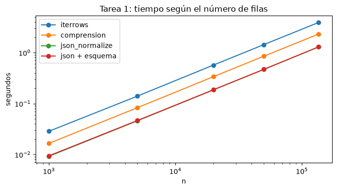
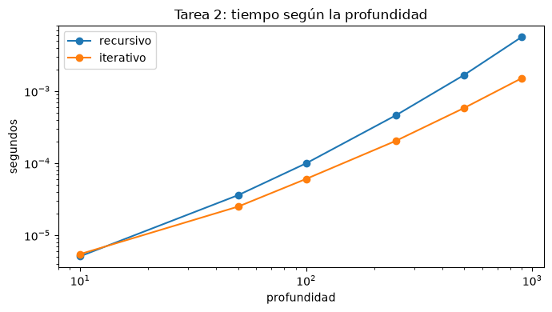
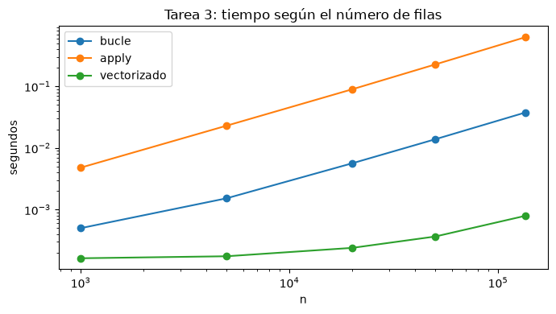

# Informe técnico · Avance del proyecto, Fase 3 – Semana 2

## I. Portada e índice

| Campo | Contenido |
|---|---|
| Curso y código | MCDI500 · Programación para la Ciencia de Datos (sección MCDI500.202683.1529.EL.ON) |
| Programa | Magíster en Ciencia de Datos e Inteligencia Artificial · Universidad Andrés Bello |
| Título del proyecto | ¿Contenido o formato? Preferencias humanas en LMArena |
| Subtítulo | Avance Fase 3 – Semana 2: núcleo algorítmico, eficiencia y programación orientada a objetos |
| Integrantes | Alejandro Poirier Gómez, Angelo Morales Serrano, José Fredes Acevedo y Valentina Carvajal Jacob |
| Grupo | 6 |
| Docente responsable | Dr. Omar Salinas Silva |
| Fecha | 16 de noviembre de 2026 |
| Repositorio | https://github.com/JoseFredes/lmarena-sumativa1 |

[TOC]

---

## Resumen

Este informe presenta la tercera fase del proyecto sobre el conjunto de datos público `lmarena-ai/arena-human-preference-140k` (LMArena, 2025), que reúne 135.634 votos humanos entre pares de respuestas de modelos de lenguaje. En la Fase 2 se construyó un pipeline funcional de limpieza y transformación. En esta fase se reorganizó ese pipeline en una jerarquía de clases, se comprobó que el resultado es idéntico al de F2, se midió la eficiencia de varias implementaciones de las tareas más costosas y se amplió la batería de pruebas de 58 a 120.

Los resultados principales son tres. Primero, el pipeline orientado a objetos reproduce el de F2 sobre las 135.634 filas y las 54 columnas, y solo difiere en los dos cambios de F3 declarados en la decisión D-016. Segundo, para aplanar `conv_metadata` la mejor alternativa medida es `json_normalize` con un `reindex` al esquema aprendido, que tarda 1,3 s con el dataset completo contra 2,3 s de la comprensión de listas que usa hoy el pipeline y 3,9 s de `iterrows`. Tercero, la suma vectorizada del puntaje de formato es unas 48 veces más rápida que el bucle de Python y unas 800 veces más rápida que `apply`.

---

## II. Diseño de soluciones algorítmicas eficientes

### a. Codificación funcional y arquitectura básica del script

El código de la fase está en `src/arena/` y se organiza por tarea, de modo que cada módulo tiene un propósito y se puede probar por separado:

| Módulo | Qué hace |
|---|---|
| `carga.py` | Lee un archivo, verifica que tenga las columnas esperadas y carga los 7 archivos Parquet del dataset sin las columnas de texto. |
| `transformadores.py` | Clases que transforman el DataFrame paso a paso y la función recursiva `recorrer()`. |
| `pipeline.py` | `Pipeline`, que ejecuta los transformadores en orden. |
| `medicion.py` | `medir()`, `mejor_tiempo()` y `comparar()`, para medir tiempo y memoria de forma reproducible. |
| `eficiencia.py` | Implementaciones alternativas de las tareas que se comparan en el análisis de eficiencia. |
| `preprocessing.py` | Funciones de F2 (`flatten`, `convert_types`, `derive_variables`, `clean_dataset`), que sirven de línea base. |

Las funciones reciben parámetros explícitos, devuelven un resultado y no modifican sus entradas. Por ejemplo, `medir(funcion, *args, **kwargs)` ejecuta cualquier función, y devuelve su resultado, el tiempo transcurrido y el pico de memoria en MB. Un error dentro de la función medida no deja encendido el rastreo de memoria, porque `tracemalloc.stop()` está en un bloque `finally`. Cada función documenta lo que recibe y lo que devuelve, y los comentarios explican el motivo de las decisiones, no lo que ya dice el código.

El flujo de datos es lineal y se puede verificar en cada paso: `cargar_lmarena()` entrega las 135.634 filas con 11 columnas; el pipeline aplana las dos columnas anidadas, convierte tipos y deriva las variables de estilo; y la salida tiene 54 columnas en F2 y 53 en F3. Cada transformador registra lo que aprendió (por ejemplo, las categorías de `winner`) y se puede consultar con la propiedad `parametros`.

### b. Preprocesamiento y transformación del dataset

El pipeline de F3 tiene nueve pasos, que parten de los siete de F2 (`pasos_f2()`) y agregan dos (`pasos_f3()`). La tabla resume cada transformación y su justificación:

| Paso | Transformador | Qué hace | Por qué |
|---|---|---|---|
| 1 | `AplanadorConvMetadata` | Expande `conv_metadata` en 26 columnas. | Los conteos de tokens y de formato Markdown están dentro de un diccionario; la pregunta de investigación los necesita como columnas. |
| 2 | `AplanadorCategoryTag` | Expande `category_tag` en 12 columnas. | Permite controlar por tipo de prompt. |
| 3 | `ConversorCategoria("winner")` | Convierte a categoría con 4 valores. | El resultado tiene cuatro valores posibles y no admite orden. |
| 4 | `ConversorCategoria("language")` | Convierte a categoría con 126 valores. | Reduce memoria y deja claro que es una variable nominal. |
| 5 | `ConversorTipo("is_code", "bool")` | Asegura el tipo lógico. | La columna solo toma dos valores. |
| 6 | `ConversorTipo("evaluation_order", "int16")` | Reduce el entero. | El orden dentro de la sesión es un número pequeño. |
| 7 | `DerivadorEstilo` | Crea `format_a/b`, `tokens_log_a/b`, `longer_response`, `more_formatted` y `winner_binary`. | Son las variables de la pregunta P1: longitud y formato de cada respuesta. |
| 8 | `EliminadorColumnas("cat_creative_writing_score")` | Elimina una columna redundante (D-016). | Repite lo que dice `cat_creative_writing`. |
| 9 | `ConversorTipo("cat_if_score", "Int8")` | Convierte a entero que admite nulos (D-016). | Solo contiene enteros de 0 a 5 y 2 nulos. |

**Valores faltantes.** Las 11 columnas originales no tienen nulos. Al aplanar `category_tag` aparecen 17 nulos en las columnas `*_score` (0,0125 % de las filas): 15 en `cat_creative_writing_score` y 2 en `cat_if_score`. Vienen así en el dato original, no los genera el código. No se imputan, porque no hay un valor razonable que inventar y afectan a una fracción mínima de filas. En F3 la columna `cat_creative_writing_score` se elimina, así que solo quedan los 2 nulos de `cat_if_score`, que se conservan como `<NA>` en el tipo `Int8`. Las filas no se eliminan: se conservan las 135.634 para no introducir un sesgo de selección prematuro.

**Transformación de variables.** Los tokens tienen una distribución muy asimétrica (mediana de 748 y máximo de 137.128 en F2). Por eso se conserva el conteo crudo y se agrega `tokens_log_a/b = log(1 + tokens)` con `np.log1p`, que es el logaritmo natural y admite los 61 y 58 casos de respuestas con 0 tokens. El tipo `float32` basta para esa variable derivada.

**Normalización y escalamiento.** No se estandarizan ni se llevan a un rango común las variables numéricas, y es una decisión, no un olvido. La pregunta P1 compara conteos y proporciones (cuántas veces gana la respuesta más larga o con más formato), y esas medidas no cambian si se reescalan las variables. El escalamiento sí importa en modelos que usan distancias o gradientes, como regresiones regularizadas o k vecinos más cercanos, que quedan para una fase posterior. La corrección de la asimetría, que es lo que sí afecta a las comparaciones, se resuelve con `log1p`. Si más adelante se necesita escalar, el diseño lo permite sin tocar el resto: bastaría un transformador que aprenda la media y la desviación en `ajustar()` y las aplique en `aplicar()`, de modo que los parámetros salgan del conjunto de ajuste y no del de prueba.

**Validación del resultado.** El notebook `F3_01` comprueba que el resultado de `pasos_f2()` es idéntico al de `clean_dataset()` sobre las 135.634 filas y las 54 columnas, y que `pasos_f3()` solo difiere de F2 en la columna eliminada y en el cambio de tipo. Las comprobaciones se repiten de forma automática en `tests/test_transformadores.py`.

### c. Validación técnica y verificación del código

La suite de `pytest` pasó de 58 a 120 pruebas, y las 62 nuevas se reparten así:

| Archivo | Pruebas | Qué cubre |
|---|---|---|
| `tests/test_transformadores.py` | 24 | Cada clase con un caso normal, casos límite y errores. |
| `tests/test_pipeline.py` | 9 | Orden de ejecución, errores de uso y la equivalencia con F2. |
| `tests/test_carga.py` | 9 | Lectura de formatos, columnas faltantes y errores de esquema. |
| `tests/test_medicion.py` | 6 | Resultado, tiempo, memoria y la tabla de comparación. |
| `tests/test_eficiencia.py` | 14 | Que todas las versiones de cada tarea den el mismo resultado. |

Los casos se agrupan así:

- **Normales:** cada transformador produce lo esperado con datos pequeños construidos a mano.
- **Límite:** un diccionario vacío en `recorrer()`, un `Pipeline` sin pasos, valores que el ajuste no vio (quedan como nulo en `ConversorCategoria`) y un conjunto nuevo al que le falta una clave del diccionario anidado (el aplanador conserva el esquema aprendido).
- **Excepciones:** `transformar()` antes de `ajustar()` lanza `RuntimeError`; agregar al `Pipeline` un objeto que no es un `Transformador` lanza `TypeError`; una columna inexistente lanza `KeyError`; y convertir un texto como `"a"` a `int16` lanza `ValueError`. En cambio, un entero con faltantes se convierte sin problema a `Int8`, que admite nulos.
- **Equivalencia con F2:** una prueba compara `pasos_f2()` con `clean_dataset()` sobre datos sintéticos y otra sobre un archivo real, que se omite si los datos no están descargados.

Los resultados intermedios quedan como evidencia en las celdas ejecutadas de `F3_01` y `F3_02`, y la salida de `pytest` se guarda en `docs/evidence/pytest.txt` al correr `make test`. La verificación es trazable: cada prueba lleva el nombre de lo que comprueba, y las decisiones sobre qué se prueba están en los PR #20 y #21.

### d. Eficiencia y optimización

El notebook `F3/F3_02_eficiencia.ipynb` compara varias implementaciones de tres tareas del pipeline. Las funciones están en `src/arena/eficiencia.py`.

**Método.** El tiempo es el mínimo de tres repeticiones con `timeit.repeat`, porque el ruido del sistema solo puede sumar tiempo (Python Software Foundation, s. f.-a). La memoria es el pico de `tracemalloc` en una ejecución aparte, para que medirla no altere el tiempo (Python Software Foundation, s. f.-b). Se mide con 1.000, 5.000, 20.000, 50.000 y 135.634 filas, y se ajusta una recta a `log(valor)` contra `log(n)` para estimar el exponente de crecimiento. Antes de medir, se comprueba que todas las versiones de una tarea dan el mismo resultado. Las mediciones se hicieron en Python 3.12 sobre macOS, con las versiones fijadas en `requirements.txt`.

**Tarea 1. Aplanar `conv_metadata`** (135.634 filas, 26 columnas):

| Implementación | Segundos | Pico de memoria (MB) | Veces más lenta |
|---|---|---|---|
| `json_normalize` + `reindex` al esquema | 1,29 | 319 | 1,0 |
| `json_normalize` | 1,29 | 319 | 1,0 |
| Comprensión de listas | 2,32 | 306 | 1,8 |
| `iterrows` | 3,91 | 323 | 3,0 |



*Figura 1. Tiempo de aplanado según el número de filas. Elaboración propia con `F3_02_eficiencia.ipynb`.*

Las cuatro versiones crecen de forma lineal (exponente 1,0 en tiempo y en memoria), así que difieren en la constante. `iterrows` pierde porque arma una Series completa por cada fila. `json_normalize` (The pandas development team, 2026) por sí sola no sirve para el pipeline: deduce las columnas de lo que encuentra y, con datos que solo traen `sum_user_tokens`, entrega 1 columna en vez de 26. Con un `reindex` al esquema que aprende `ajustar()` da exactamente el mismo DataFrame que la comprensión de listas y tarda lo mismo que `json_normalize`.

**Tarea 2. Recorrer un diccionario anidado** (recursión contra iteración con pila propia, con diccionarios sintéticos de profundidad creciente):

| Profundidad | Iterativa (ms) | Recursiva (ms) |
|---|---|---|
| 10 | 0,006 | 0,005 |
| 100 | 0,061 | 0,100 |
| 500 | 0,584 | 1,675 |
| 900 | 1,513 | 5,651 |



*Figura 2. Tiempo de recorrido según la profundidad. Elaboración propia con `F3_02_eficiencia.ipynb`.*

Con profundidad 900 la versión iterativa es unas 3,7 veces más rápida. Con profundidad 2.000 la recursiva falla con `RecursionError`, porque el límite de Python es 1.000 (Python Software Foundation, s. f.-c), y la iterativa recorre las 2.002 hojas sin problema. En los datos reales el anidamiento es de 2 niveles, y ahí la diferencia no se nota.

**Tarea 3. Puntaje de formato por fila** (suma de encabezados, listas y negritas del lado A):

| Implementación | Segundos (135.634 filas) | Pico de memoria (MB) |
|---|---|---|
| Suma vectorizada | 0,0008 | 1,0 |
| Bucle de Python | 0,038 | 27,3 |
| `apply` por fila | 0,630 | 20,3 |



*Figura 3. Tiempo de cálculo del puntaje de formato según el número de filas. Elaboración propia con `F3_02_eficiencia.ipynb`.*

La vectorizada es unas 48 veces más rápida que el bucle y unas 800 veces más rápida que `apply`, porque el cálculo se hace en código compilado de NumPy (Harris et al., 2020) y no fila por fila en el intérprete. `apply` es la peor porque llama a una función de Python por fila y crea una Series en cada llamada. El exponente de 0,3 de la vectorizada no significa que crezca menos que lineal: con tiempos tan cortos pesa el costo fijo de cada llamada.

En el notebook `F3_01` también se compara un bucle fila por fila de todo `derive_variables` contra su versión vectorizada, con 20.000 filas (1,0 s contra 0,005 s, unas 215 veces). Es una comparación distinta de la tarea 3: aquella mide las siete variables derivadas y esta solo el puntaje de formato, por eso las razones no coinciden.

**Complejidad y elección final.** Con `n` filas, `k` hojas por fila (26), `d` profundidad del diccionario, `h` hojas y `c` columnas que se suman:

| Tarea | Versión | Tiempo | Espacio extra |
|---|---|---|---|
| 1 | `iterrows`, comprensión, `json_normalize` (con o sin `reindex`) | O(n·k) | O(n·k) |
| 2 | Recursiva | O(h·d) | O(h·d) de salida + O(d) de pila, con tope |
| 2 | Iterativa | O(h·d) | O(h·d) de salida + O(d) de pila propia, sin tope |
| 3 | Bucle, `apply`, vectorizada | O(n·c) | O(n) |

Las decisiones son:

1. **Aplanar:** `json_normalize` más `reindex` al esquema aprendido. Es la más rápida, usa la misma memoria y mantiene el contrato del `Transformador`: las mismas 26 columnas en el mismo orden aunque falten claves. El pipeline actual usa la comprensión de listas; cambiarlo ahorraría cerca de 1 s sobre el dataset completo. No se aplicó en esta fase para no modificar el pipeline sin acordarlo en el equipo.
2. **Recorrer:** se mantiene la recursiva en el pipeline, porque con 2 niveles no hay diferencia y es más fácil de leer. La iterativa queda como alternativa si el anidamiento fuera muy profundo.
3. **Formato:** suma vectorizada, que es la que ya usa `derive_variables` en F2.

### e. Diseño estructurado del código

**Cohesión y acoplamiento.** Cada transformador hace una sola cosa: `AplanadorConvMetadata` solo aplana metadatos y `ConversorCategoria` solo convierte una columna a categoría. Los transformadores no se conocen entre sí: el `Pipeline` los recorre en secuencia y el único contrato es la interfaz `ajustar` / `transformar`, así que se pueden agregar, quitar o reordenar pasos sin tocar los demás. La excepción parcial es `DerivadorEstilo`, que necesita que las columnas Markdown ya estén aplanadas; si no lo están, lanza un `KeyError` con un mensaje que lo explica.

**Flujo de datos.** Cada paso recibe un DataFrame, lo copia, lo transforma y lo devuelve; así el original no cambia. `ajustar()` aprende los parámetros del conjunto de ajuste y `transformar()` los aplica, lo que evita que un conjunto nuevo cambie las categorías o las columnas.

**Recursividad.** `recorrer(valor, ruta)` es un generador recursivo que entrega `(ruta, hoja)` por cada hoja de un diccionario anidado, a cualquier profundidad. El caso base es un valor que no es diccionario, y el caso recursivo desciende por cada clave con `yield from`. `AplanadorAnidado` la usa para construir un diccionario plano por fila.

**Escalabilidad.** Para sumar una transformación nueva basta una clase que herede de `Transformador` e implemente `aprender()` y `aplicar()`. El análisis de eficiencia dejó medido en qué puntos el diseño actual tiene margen de mejora (el aplanado) y en cuáles no (el puntaje de formato).

---

## III. Implementación de código modular y robusto

### a. Programación orientada a objetos

La jerarquía parte de una clase base y se especializa en seis familias de hijas:

```text
Transformador                    ajustar() · transformar() · ajustar_transformar()
├── AplanadorAnidado             usa recorrer(); define nombre_columna()
│   ├── AplanadorConvMetadata    26 columnas, claves Markdown renombradas
│   └── AplanadorCategoryTag     12 columnas
├── ConversorCategoria           categorías aprendidas en ajustar()
├── ConversorTipo                tipo fijo (bool, int16, Int8)
├── DerivadorEstilo              7 variables de estilo
└── EliminadorColumnas           quita columnas redundantes
```

**Herencia.** `Transformador` implementa lo que es común (validar la columna, copiar el DataFrame, llevar el registro de si fue ajustado) y deja a cada hija solo lo propio. `AplanadorConvMetadata` y `AplanadorCategoryTag` heredan de `AplanadorAnidado`, que concentra el recorrido recursivo, y solo definen cómo se nombra cada columna.

**Polimorfismo.** El `Pipeline` llama a `ajustar_transformar()` sobre cada paso sin saber de qué clase es. Cada hija responde de forma distinta al mismo mensaje, y por eso se pueden incorporar transformadores nuevos sin modificar el `Pipeline`.

**Encapsulamiento.** Los parámetros aprendidos viven en `_parametros` y se leen con la propiedad `parametros`, que devuelve una copia, de modo que nadie los cambia desde fuera por error. El indicador `_ajustado` impide llamar a `transformar()` antes de `ajustar()`.

```python
class Transformador:
    def ajustar(self, df):
        self._parametros = self.aprender(df)   # cada hija decide qué aprender
        self._ajustado = True
        return self

    def transformar(self, df):
        if not self._ajustado:
            raise RuntimeError(f"{self.nombre}: hay que ajustar antes de transformar.")
        return self.aplicar(df.copy())          # cada hija decide cómo aplicar

    @property
    def parametros(self):
        return dict(self._parametros)           # copia: el estado interno no se toca
```

El diseño sigue el patrón Template Method (Gamma et al., 1994): la clase base fija la secuencia y las hijas completan `aprender()` y `aplicar()`. Los métodos tienen docstring con lo que reciben y devuelven.

### b. Documentación de arquitectura y funcionalidad del código

La documentación está repartida en cuatro lugares que se corresponden entre sí:

- **Código:** docstrings y comentarios en `src/arena/`, que explican el motivo de cada decisión.
- **Notebooks:** `F3_01_pipeline_poo.ipynb` documenta la arquitectura de clases, la recursión y la equivalencia con F2, y `F3_02_eficiencia.ipynb` las mediciones y decisiones. Ambos tienen celdas de texto antes de cada bloque de código, que dicen qué se hace y por qué.
- **Bitácora de decisiones:** `docs/decisiones.md`, con la decisión D-016 de esta fase (eliminar `cat_creative_writing_score` y convertir `cat_if_score` a `Int8`) y la justificación de los datos.
- **Historial de PR:** cada cambio de la fase entró por un pull request con su descripción, de modo que la evolución y el razonamiento se pueden seguir en orden.

---

## IV. Repositorio GitHub (F3)

El repositorio es https://github.com/JoseFredes/lmarena-sumativa1 y conserva las fases anteriores:

| Carpeta o archivo | Contenido |
|---|---|
| `F1/` | Notebook de definición del problema y mapa conceptual. |
| `F2/` | Cuatro notebooks de obtención, exploración, limpieza, validación y distribución de tokens. |
| `F3/` | `F3_01_pipeline_poo.ipynb` (POO, recursión y equivalencia con F2) y `F3_02_eficiencia.ipynb` (comparación de implementaciones), más su `README.md`. |
| `src/arena/` | Paquete modular con el código de las tres fases. |
| `tests/` | 120 pruebas automáticas. |
| `docs/` | Bitácora de decisiones, diccionario de variables y evidencias. |
| `Makefile` | `make all` instala, descarga, prueba y ejecuta los notebooks de F1, F2 y F3. |

**README técnico.** Explica cómo instalar el entorno, descargar los datos y ejecutar cada notebook, con `make all` o por pasos. Los dos notebooks de F3 se ejecutan sin errores en 3 min 7 s en total.

**Historial de commits y PR.** Los cambios de la fase entraron por ocho pull requests:

| PR | Autoría | Qué incorpora |
|---|---|---|
| #16 y #19 | Angelo Morales | Clases de transformación, `carga.py`, `medicion.py`, decisión D-016 y pasos de F3. |
| #22 | Alejandro Poirier | Notebook `F3_01`, y el ajuste de `DerivadorEstilo` para que use los parámetros aprendidos. |
| #20 | José Fredes | 48 pruebas de transformadores, pipeline, carga y medición, y la prueba de equivalencia con F2. |
| #21 | José Fredes | `eficiencia.py`, 14 pruebas y el notebook `F3_02`. |
| #23 a #25 | José Fredes | Corrección de docstrings, consistencia de textos sobre nulos, `make run` con F3 y `ConversorCategoria` sin el aviso de pandas. |

**Contribuciones individuales.** La evidencia es el historial de commits y de PR (`git log` y `gh pr list`). En F3, Angelo Morales aportó la estructura de clases, la carga y la medición; Alejandro Poirier, el notebook de POO y la corrección del derivador; y José Fredes, las pruebas, el análisis de eficiencia y la consistencia de la documentación. Valentina Carvajal Jacob participó en las fases 1 y 2 (informe, mapa conceptual, distribución de tokens y evidencias de ejecución).

---

## V. Notebooks ejecutables (F3)

| Notebook | Contenido | Estado |
|---|---|---|
| `F3/F3_01_pipeline_poo.ipynb` | Línea base de F2, jerarquía de clases, parámetros aprendidos, equivalencia F2 = F3, recursión con `recorrer()`, validaciones y patrones de diseño. | Ejecutado de punta a punta, sin errores. |
| `F3/F3_02_eficiencia.ipynb` | Tres tareas con varias implementaciones cada una, tablas de tiempo y memoria, exponentes empíricos, complejidad y decisiones. | Ejecutado de punta a punta, sin errores. |

Ambos integran las funciones de F2 (como línea base), los módulos orientados a objetos, la función recursiva y las mediciones. Cada celda de código está precedida por una celda de texto, y los resultados quedan guardados. La reproducibilidad se asegura con las versiones fijadas en `requirements.txt`, la semilla registrada en el notebook de eficiencia y el comando `make run`. Las secciones de este informe se corresponden con las de los notebooks: la sección II.d con `F3_02`, y las secciones II.a, II.b y III con `F3_01`.

---

## VI. Bibliografía

Chiang, W.-L., Zheng, L., Sheng, Y., Angelopoulos, A. N., Li, T., Li, D., Zhu, B., Zhang, H., Jordan, M., Gonzalez, J. E., & Stoica, I. (2024). Chatbot Arena: An open platform for evaluating LLMs by human preference. En *Proceedings of the 41st International Conference on Machine Learning* (Vol. 235, pp. 8359–8388). Proceedings of Machine Learning Research. https://proceedings.mlr.press/v235/chiang24b.html

Gamma, E., Helm, R., Johnson, R., & Vlissides, J. (1994). *Design patterns: Elements of reusable object-oriented software*. Addison-Wesley.

*Guía de desarrollo — Evaluación Sumativa 1 (Fases 1 y 2).* (s. f.). Material docente de MCDI500, Universidad Andrés Bello. https://github.com/magistercienciadatos/Material_Didactico_Semana1/blob/main/4_Gu%C3%ADas_de_Apoyo/Guia_desarrollo_Sumativa1_Fases1y2.docx

Harris, C. R., Millman, K. J., van der Walt, S. J., Gommers, R., Virtanen, P., Cournapeau, D., Wieser, E., Taylor, J., Berg, S., Smith, N. J., Kern, R., Picus, M., Hoyer, S., van Kerkwijk, M. H., Brett, M., Haldane, A., del Río, J. F., Wiebe, M., Peterson, P., … Oliphant, T. E. (2020). Array programming with NumPy. *Nature, 585*(7825), 357–362. https://doi.org/10.1038/s41586-020-2649-2

LMArena. (2025). *Arena-human-preference-140k* [Conjunto de datos]. Hugging Face. https://huggingface.co/datasets/lmarena-ai/arena-human-preference-140k

magistercienciadatos. (2026). *MCDI500 · Material didáctico de la Semana 1* [Repositorio de materiales del curso]. GitHub. https://github.com/magistercienciadatos/Material_Didactico_Semana1

Python Software Foundation. (s. f.-a). *timeit — Measure execution time of small code snippets* (Python 3.12 documentation). https://docs.python.org/3.12/library/timeit.html

Python Software Foundation. (s. f.-b). *tracemalloc — Trace memory allocations* (Python 3.12 documentation). https://docs.python.org/3.12/library/tracemalloc.html

Python Software Foundation. (s. f.-c). *sys.getrecursionlimit* (Python 3.12 documentation). https://docs.python.org/3.12/library/sys.html#sys.getrecursionlimit

Salinas Silva, O. (2026). *Apuntes técnicos Semana 1: Estructura de datos, funciones, módulos, manejo de excepciones, NumPy y Pandas* [Material docente]. MCDI500 Programación para la Ciencia de Datos, Universidad Andrés Bello.

*Sumativa 2. Avance del proyecto fase 3 – Núcleo algorítmico, eficiencia e implementación orientada a objetos.* (2026). Enunciado y rúbrica de MCDI500, Universidad Andrés Bello (Canvas).

The pandas development team. (2026). *pandas.json_normalize* (pandas documentation, versión 3.1). https://pandas.pydata.org/docs/reference/api/pandas.json_normalize.html

---

## Anexos

- **A.** Notebooks ejecutados: `F3/F3_01_pipeline_poo.ipynb` y `F3/F3_02_eficiencia.ipynb`.
- **B.** Implementaciones alternativas: `src/arena/eficiencia.py`.
- **C.** Pruebas: `tests/` y salida de `pytest` en `docs/evidence/pytest.txt`.
- **D.** Bitácora de decisiones: `docs/decisiones.md` (D-016).
- **E.** Historial de pull requests: `gh pr list --state all` en el repositorio.
