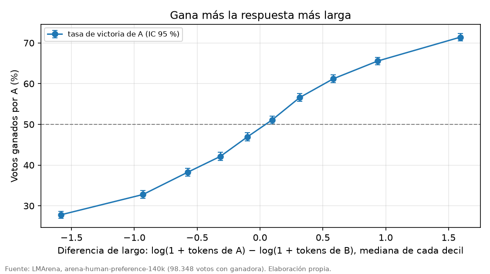
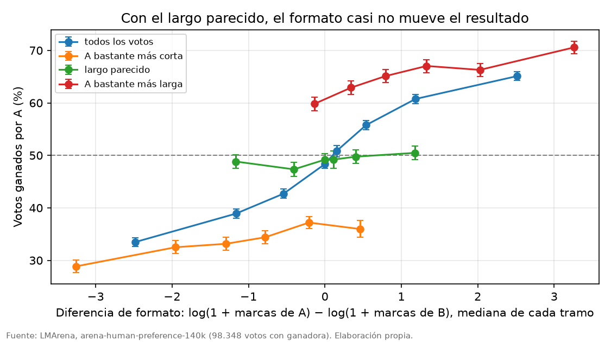
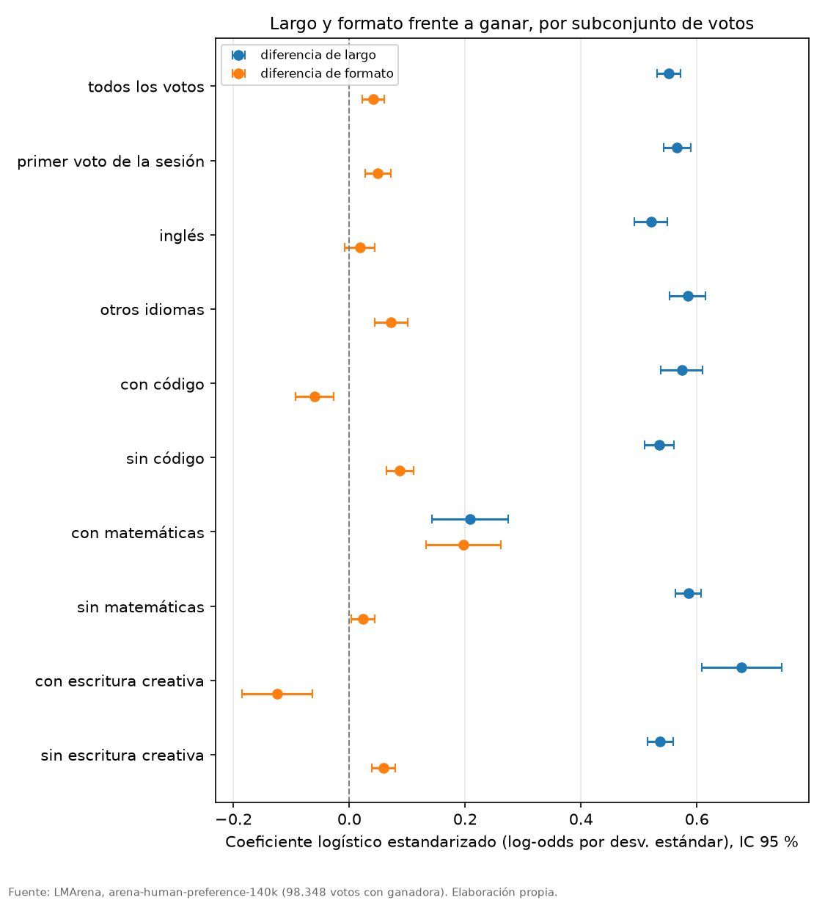

# Informe final · Proyecto integrador, Fase 4

## I. Portada e índice

| Campo | Contenido |
|---|---|
| Curso y código | MCDI500 · Programación para la Ciencia de Datos (sección MCDI500.202683.1529.EL.ON) |
| Programa | Magíster en Ciencia de Datos e Inteligencia Artificial · Universidad Andrés Bello |
| Título del proyecto | ¿Contenido o formato? Preferencias humanas en LMArena |
| Subtítulo | Análisis, reproducibilidad y comunicación de resultados (Fases 1 a 4) |
| Integrantes | Alejandro Poirier Gómez, Angelo Morales Serrano, José Fredes Acevedo y Valentina Carvajal Jacob (Grupo 6) |
| Docente responsable | Dr. Omar Salinas Silva |
| Fecha | 24 de noviembre de 2026 |
| Repositorio | https://github.com/JoseFredes/lmarena-sumativa1 |

[TOC]

---

## II. Introducción y contextualización

Los modelos de lenguaje de gran tamaño se comparan cada vez más con evaluaciones de preferencia humana: una persona recibe dos respuestas anónimas y vota por la que prefiere. La plataforma más conocida es Chatbot Arena, hoy LMArena (Chiang et al., 2024), y sus resultados ordenan los modelos y orientan cuáles se adoptan. Ese uso supone que el voto refleja la calidad, pero también podría reflejar el estilo: una respuesta más larga, o con más listas, encabezados y negritas, puede parecer mejor sin serlo. Dubois et al. (2024) documentan este sesgo en evaluadores automáticos, y Li et al. (2024) lo corrigen en la propia plataforma con un control de estilo. Si el sesgo existe, los rankings miden mal la capacidad real de los modelos.

El proyecto estudia esa situación con el conjunto público `arena-human-preference-140k` (LMArena, 2025): 135.634 votos entre el 17 de abril y el 24 de julio de 2025, con 53 modelos y 126 idiomas. **El objetivo general** es determinar si la extensión y el formato de las respuestas se asocian con la preferencia humana, considerando el par de modelos comparados. El alcance es descriptivo: se habla de asociaciones, no de causas.

El problema requiere programación por tres razones: el volumen (7 archivos, 1,6 GB), la estructura (columnas anidadas que hay que aplanar) y la heterogeneidad (idiomas, longitudes muy asimétricas y votos agrupados en sesiones). Las cuatro fases siguen la estructura del proyecto integrador (*Sumativa 3*, 2026) y se encadenan: **F1** define el problema y el entorno; **F2** obtiene, explora, limpia y valida el dato; **F3** reorganiza el código en clases, comprueba que el resultado no cambia y mide su eficiencia; **F4** responde la pregunta y comunica los resultados.

## III. Definición de la problemática y objetivos

**Problemática.** Las evaluaciones por preferencia se usan como medida de calidad, pero sus resultados podrían estar asociados a rasgos de forma (extensión, formato) que no reflejan calidad. Se desconoce cuánto se relacionan con las preferencias registradas en LMArena.

**Pregunta central (P1).** ¿Las respuestas más largas y con más elementos de formato tienden a ganar con mayor frecuencia?

**Objetivos específicos.** (OE1) Configurar un entorno reproducible y un repositorio versionado. (OE2) Obtener el dato con verificación de integridad y documentar su estructura. (OE3) Limpiar y transformar el dato y derivar las variables de extensión y formato. (OE4) Validarlo con chequeos y pruebas de casos normales, límite y excepciones. (OE5) Reorganizar el código en clases, comprobar la equivalencia con F2 y medir su eficiencia. (OE6) Estimar la asociación entre largo, formato y victoria, con control por modelo, y comunicarla con gráficos.

**Alcance.** Se aborda P1 sobre los 98.348 votos con ganadora (72,5 % del total). No se aborda causalidad, calidad del contenido ni modelos predictivos.

**Restricciones y supuestos.** Ventana de tres meses con recolección despareja; las filas de una misma sesión no son independientes (el 79,9 % de los votos es el primero de su sesión); la ficha no define `tie` ni `both_bad`; los prompts pueden contener datos personales, así que solo se usa su longitud y no se publica texto; los conteos de `conv_metadata` miden extensión y formato, no calidad. Las 11 columnas originales no tienen nulos; al aplanar `category_tag` aparecen 17 en columnas `*_score` (0,0125 %), que vienen así en el dato original.

## IV. Aplicación de herramientas científicas

**Librerías.** NumPy y pandas para el procesamiento, Matplotlib para los gráficos, pyarrow para leer Parquet, Jupyter y `nbconvert` para los notebooks y pytest para las pruebas. La regresión logística de F4 se escribió con NumPy (mínimos cuadrados ponderados iterados), así no se agregaron dependencias (Harris et al., 2020; The pandas development team, 2026).

**Reproducibilidad.** Siguiendo las prácticas del curso (magistercienciadatos, 2026; Salinas Silva, 2026), el entorno es un `.venv` de Python 3.12 con las versiones fijadas en `requirements.txt`. `make all` instala, descarga los 7 archivos y los verifica contra `CHECKSUMS.txt`, corre las pruebas, ejecuta los notebooks de F1 a F4 y guarda las evidencias en `docs/evidence/` (pruebas, log de `nbconvert` y versiones). Se probó desde un clon limpio y en Windows, y cada notebook registra versiones y commit al inicio.

**Control de versiones.** El repositorio tiene 100 commits propios de las cuatro personas (JoseFredes 59, Valentina Carvajal 21, Angelo Morales 11, Alejandro Poirier 9), con mensajes de la forma `tipo(ámbito): qué se hizo`, 27 pull requests y ramas por tema. No se hace *squash*: el historial es la evidencia.

**Documentación.** `docs/decisiones.md` registra 16 decisiones con su justificación y evidencia (por ejemplo, D-008 muestreo por sesiones y D-016 eliminar `cat_creative_writing_score`). Cada fase tiene README y notebooks con texto antes de cada bloque de código.

**Repositorio.** Carpetas `F1/` a `F4/`, paquete `src/arena/`, `tests/`, `docs/` y `report/`, con README técnico, `changelog.md` y los informes de cada fase. Las contribuciones se identifican por autor de commit y de PR (sección XI).

## V. Diseño de soluciones algorítmicas eficientes

**a. Codificación funcional.** Cada módulo de `src/arena/` tiene un propósito: `io` (descarga y SHA-256), `profile` (inspección), `preprocessing` (limpieza de F2), `validation`, `carga`, `transformadores` y `pipeline` (F3), `medicion` y `eficiencia` (F3), `analisis` y `plots` (F4). Las funciones reciben parámetros explícitos, no modifican sus entradas y llevan docstring con lo que reciben y devuelven.

**b. Preprocesamiento.** Un pipeline de nueve pasos, `pasos_f3()`, pasa de 135.634 × 11 a 135.634 × 53 sin perder filas:

| Pasos | Qué hacen | Por qué |
|---|---|---|
| 1–2 | Aplanan `conv_metadata` (26 columnas) y `category_tag` (12) | Los conteos de tokens y formato están anidados y P1 los necesita como columnas. |
| 3–6 | Categoría para `winner` (4) y `language` (126); `bool` y `int16` | Variables nominales sin orden; menos memoria. |
| 7 | Deriva `format_a/b`, `tokens_log_a/b`, `longer_response`, `more_formatted` y `winner_binary` | Son las variables de P1. `log1p` corrige la asimetría (mediana 748, máximo 137.128) y admite los 61 y 58 casos de 0 tokens. |
| 8–9 | Elimina `cat_creative_writing_score`; `cat_if_score` a `Int8` | La primera repite a `cat_creative_writing`; la segunda solo tiene enteros de 0 a 5 (D-016). |

*Valores faltantes:* quedan 2 nulos, ambos en `cat_if_score`, que se conservan como `<NA>`: no hay un valor razonable que imputar y afectan una fracción mínima. *Normalización:* no se estandariza porque P1 compara proporciones y odds, que no cambian al reescalar; para comparar coeficientes se estandarizan solo en el modelo. *Validación:* `validate_dataset` no da fallas críticas (filas conservadas, `id` únicos, valores en rango) y una advertencia conocida (10 filas con el mismo modelo).

**c. Validación técnica.** Hay 150 pruebas automáticas, sin red y con datos simulados. Cubren casos normales (cada clase con datos a mano), límite (diccionario vacío, `Pipeline` sin pasos, valores no vistos en el ajuste, claves faltantes) y excepciones (`transformar` antes de `ajustar` lanza `RuntimeError`, objeto inválido en el `Pipeline` lanza `TypeError`, columna ausente lanza `KeyError`). Una prueba compara `pasos_f2()` con `clean_dataset()` sobre las 135.634 filas y 54 columnas, y las funciones de análisis se validan recuperando coeficientes conocidos de datos simulados.

**d. Eficiencia y optimización.** Se comparó con `timeit` (mínimo de 3 repeticiones), `tracemalloc` para memoria (Python Software Foundation, s. f.-a, s. f.-b) y exponentes empíricos por ajuste en escala logarítmica, con 1.000 a 135.634 filas:

| Tarea | Alternativas medidas (135.634 filas) | Elección |
|---|---|---|
| Aplanar `conv_metadata` | `iterrows` 3,9 s; comprensión 2,3 s; `json_normalize` 1,3 s | `json_normalize` + `reindex` al esquema aprendido: mismo resultado, 1,8 veces más rápido |
| Recorrer un diccionario anidado | Recursión e iteración con pila (profundidad 900: 5,7 ms contra 1,5 ms) | Recursiva en el pipeline (2 niveles); iterativa si hubiera mucha profundidad, porque con 2.000 niveles la recursiva falla |
| Puntaje de formato | Bucle 38 ms; `apply` 630 ms; vectorizada 0,8 ms | Suma vectorizada: 48 veces más rápida que el bucle |

Las tres tareas son O(n·k) o O(n·c) en tiempo, con espacio proporcional a la salida; el aplanado crece de forma lineal (exponente 1,0). La elección del aplanador queda pendiente de acuerdo del equipo, porque cambiaría el pipeline de F3.

**e. Diseño estructurado.** Alta cohesión (cada transformador hace una sola cosa) y bajo acoplamiento (el `Pipeline` solo conoce la interfaz `ajustar`/`transformar`). La recursividad aplana diccionarios anidados con `recorrer(valor, ruta)`, un generador con caso base (hoja) y caso recursivo (`yield from`). Para agregar una transformación basta una clase nueva con `aprender()` y `aplicar()`.

## VI. Implementación de código modular y robusto

**Programación orientada a objetos.** Ocho clases en `transformadores.py` y un `Pipeline`:

```text
Transformador                 ajustar() · transformar() · ajustar_transformar()
├── AplanadorAnidado          usa recorrer(); define nombre_columna()
│     ├── AplanadorConvMetadata
│     └── AplanadorCategoryTag
├── ConversorCategoria · ConversorTipo
└── DerivadorEstilo · EliminadorColumnas
```

*Herencia:* la clase base concentra lo común (validar la columna, copiar el DataFrame, registrar si fue ajustado). *Polimorfismo:* el `Pipeline` llama a `ajustar_transformar()` sin saber de qué clase es cada paso. *Encapsulamiento:* lo aprendido vive en `_parametros` y se lee por una propiedad que devuelve una copia. El diseño sigue el patrón Template Method (Gamma et al., 1994): la base fija la secuencia y las hijas completan `aprender()` y `aplicar()`.

```python
def ajustar(self, df):
    self._parametros = self.aprender(df)      # cada hija decide qué aprender
    self._ajustado = True
    return self
def transformar(self, df):
    if not self._ajustado:
        raise RuntimeError(f"{self.nombre}: hay que ajustar antes de transformar.")
    return self.aplicar(df.copy())             # cada hija decide cómo aplicar
```

**Documentación de la arquitectura.** Los docstrings explican el motivo de cada decisión, `F3_01` documenta las clases y la recursión, `F3_02` las mediciones y `docs/decisiones.md` el razonamiento de cada cambio.

## VII. Construcción de visualizaciones de datos efectivas

El dataset queda listo para graficar tras el pipeline de la sección V.b (53 columnas, 2 nulos fuera del análisis). Los tres gráficos, hechos con Matplotlib, llevan título, ejes, leyenda y fuente, y se interpretan en la sección VIII.



*Figura 1. Tasa de victoria de A según la diferencia de largo (deciles, IC 95 % de Wilson). Fuente: LMArena (2025); elaboración propia.*



*Figura 2. Tasa de victoria de A según la diferencia de formato, en todos los votos y separando por diferencia de largo. Fuente: LMArena (2025); elaboración propia.*



*Figura 3. Coeficientes logísticos de largo y formato por subconjunto de votos. Fuente: LMArena (2025); elaboración propia.*

## VIII. Metodología, resultados y discusión

**Metodología.** El análisis parte del dato crudo y pasa por `pasos_f3()`, así que se repite de punta a punta. Se dejan los votos con ganadora y se arman dos diferencias entre A y B: `dif_tokens_log` (largo en escala logarítmica) y `dif_formato_log` (formato, con `log1p`). Se calcula la tasa en que gana el lado con más largo o formato con intervalo de Wilson (1927), se ajustan regresiones logísticas con las diferencias estandarizadas y se repite el modelo en subconjuntos y con una columna por modelo (Bradley y Terry, 1952), de modo que el efecto se mide dentro de cada par.

**Resultados.**
- **Largo.** La respuesta más larga gana el 61,8 % de las veces (IC 95 % de 61,5 a 62,1 %). La tasa de A sube de 27,8 % a 71,4 % entre el decil con A más corta y el con A más larga (Figura 1).
- **Formato.** Solo, parece pesar: gana la respuesta con más formato el 59,5 % de las veces. Pero formato y largo van juntos (correlación 0,72). Con el largo parecido, la tasa se mantiene entre 47 % y 51 % sin importar el formato (Figura 2).
- **Largo y formato juntos.** El coeficiente del largo casi no cambia (de 0,58 a 0,55; odds 1,74 por desviación estándar) y el del formato cae de 0,42 a 0,04 (odds 1,04).
- **Con control por modelo** (52 modelos), el largo baja a 0,445 (odds 1,56) y el formato sube a 0,110 (odds 1,12, IC de 0,087 a 0,133).
- **Robustez** (Figura 3). El largo mantiene entre 0,52 y 0,58 en el primer voto de cada sesión, en inglés, en otros idiomas y con y sin código. El formato es pequeño, no se distingue de cero en inglés y es negativo en los votos con código (−0,06).
- **Empates.** Los votos sin ganadora se concentran cuando el largo difiere poco (32 % contra 20 % cuando una respuesta es mucho más larga), de modo que las tasas describen solo los votos en que alguien ganó.

**Validación y reflexión técnica.** Respecto de F2, el código pasó de funciones sueltas a clases sin cambiar el resultado (equivalencia comprobada) y de 58 a 150 pruebas. El grupo trabajó con ramas y pull requests, y revisó el trabajo cruzado; así aparecieron errores que las pruebas solas no detectaron (cifras desactualizadas en el informe, un docstring que decía log₁₀ y el código usa log natural). En eficiencia, la lección es que la versión más legible no siempre es la más rápida, y que medir cambió dos decisiones. En escalabilidad, el pipeline soporta 135.634 filas en segundos y crece de forma lineal; el mayor costo es el aplanado.

**Discusión.** La hipótesis de partida se confirma para el largo, que es la asociación más fuerte y estable, y se confirma de forma débil para el formato una vez controlado el largo. *Limitaciones:* no hay control de calidad (una respuesta más larga puede ser más completa), no se controla el tipo de pregunta, quedan fuera el 27,5 % de los votos sin ganadora, el formato se mide por conteos de Markdown y no por cómo se ve, y los votos de una sesión no son independientes (el primer voto de cada sesión da lo mismo, pero los intervalos del modelo completo son algo optimistas). *Riesgos:* leer los resultados como causales, y que una evaluación por preferencia premie el largo y un modelo mejore su puntaje escribiendo más sin mejorar (Dubois et al., 2024).

**Conclusiones.** (1) El largo es lo más asociado con ganar y se sostiene en todos los subconjuntos. (2) El formato aporta poco por sí solo: casi todo lo que parecía efecto del formato es largo. (3) Partir del pipeline en vez de un archivo guardado hace el análisis repetible. (4) *Mejoras:* agregar `category_tag` como control, comparar con y sin votos sin ganadora y probar una medida de formato más cercana a lo que ve la persona.

## IX. Trazabilidad de mejoras

El `changelog.md` registra 26 cambios con fecha, commit verificado y justificación, y una tabla de observaciones con sus acciones. Resumen:

| Observación | Acción | Impacto |
|---|---|---|
| Retroalimentación de la Sumativa 1: referencias a pruebas, entorno y dato procesado imprecisas | Se corrigieron y se refrescaron las evidencias (PR #17 y #18) | Documentación coherente con el repositorio |
| Revisión de F3: "0 % de nulos" cuando quedan 17; porcentajes de empates desactualizados; evidencias con 58 pruebas | Se corrigieron los textos y se regeneraron las evidencias (PR #24 y #28) | Cifras iguales en informe, README y datos |
| Aplanado lento con la comprensión de listas | Se midió una alternativa 1,8 veces más rápida (PR #21) | Rendimiento; pendiente de aplicar |
| Análisis sin control por modelo | Se agregó un Bradley-Terry con control de estilo (PR #30) | El coeficiente del largo baja de 0,55 a 0,45 |

Modularidad: de 3 funciones de limpieza a 8 clases y un `Pipeline`. Pruebas: de 25 el 4 de noviembre a 150. Documentación: 16 decisiones, un README por fase y tres informes.

## X. Presentación audiovisual

La presentación de 5 a 8 minutos se entrega en Canvas Studio. Sigue la estructura pedida: apertura, contexto, metodología (con ejecución del pipeline), resultados con los tres gráficos y conclusiones, con participación de los cuatro integrantes.

## XI. Contribuciones individuales

| Integrante | Aportes principales (evidencia: `git log --author`, `gh pr list`) |
|---|---|
| José Fredes | Entorno, descarga y verificación, exploración, validación y pruebas (F2); pruebas, eficiencia y análisis de P1 (F3 y F4). |
| Alejandro Poirier | Definición del problema (F1), limpieza (F2), notebook de POO y recursión (F3). |
| Angelo Morales | Instrucciones por notebook, diccionario de variables, módulos de carga, clases y medición (F3, D-016). |
| Valentina Carvajal | Muestra y validaciones de F1, distribución de tokens (F2_04), informe de F1/F2, mapa conceptual y evidencias de control de versiones. |

## XII. Bibliografía

Bradley, R. A., & Terry, M. E. (1952). Rank analysis of incomplete block designs: I. The method of paired comparisons. *Biometrika, 39*(3/4), 324–345. https://doi.org/10.2307/2334029

Chiang, W.-L., Zheng, L., Sheng, Y., Angelopoulos, A. N., Li, T., Li, D., Zhu, B., Zhang, H., Jordan, M., Gonzalez, J. E., & Stoica, I. (2024). Chatbot Arena: An open platform for evaluating LLMs by human preference. En *Proceedings of the 41st International Conference on Machine Learning* (Vol. 235, pp. 8359–8388). PMLR. https://proceedings.mlr.press/v235/chiang24b.html

Dubois, Y., Galambosi, B., Liang, P., & Hashimoto, T. B. (2024). *Length-controlled AlpacaEval: A simple way to debias automatic evaluators* (arXiv:2404.04475). https://doi.org/10.48550/arXiv.2404.04475

Gamma, E., Helm, R., Johnson, R., & Vlissides, J. (1994). *Design patterns: Elements of reusable object-oriented software*. Addison-Wesley.

Harris, C. R., Millman, K. J., van der Walt, S. J., Gommers, R., Virtanen, P., Cournapeau, D., Wieser, E., Taylor, J., Berg, S., Smith, N. J., Kern, R., Picus, M., Hoyer, S., van Kerkwijk, M. H., Brett, M., Haldane, A., del Río, J. F., Wiebe, M., Peterson, P., … Oliphant, T. E. (2020). Array programming with NumPy. *Nature, 585*(7825), 357–362. https://doi.org/10.1038/s41586-020-2649-2

Li, T., Angelopoulos, A., & Chiang, W.-L. (2024). *Does style matter? Disentangling style and substance in Chatbot Arena*. LMSYS. https://lmsys.org/blog/2024-08-28-style-control/

LMArena. (2025). *Arena-human-preference-140k* [Conjunto de datos]. Hugging Face. https://huggingface.co/datasets/lmarena-ai/arena-human-preference-140k

magistercienciadatos. (2026). *MCDI500 · Material didáctico de la Semana 1* [Repositorio de materiales del curso]. GitHub. https://github.com/magistercienciadatos/Material_Didactico_Semana1

Python Software Foundation. (s. f.-a). *timeit — Measure execution time of small code snippets* (Python 3.12 documentation). https://docs.python.org/3.12/library/timeit.html

Python Software Foundation. (s. f.-b). *tracemalloc — Trace memory allocations* (Python 3.12 documentation). https://docs.python.org/3.12/library/tracemalloc.html

Salinas Silva, O. (2026). *Apuntes técnicos Semana 1: Estructura de datos, funciones, módulos, manejo de excepciones, NumPy y Pandas* [Material docente]. MCDI500 Programación para la Ciencia de Datos, Universidad Andrés Bello.

*Sumativa 3. Proyecto final integrador fase 4 – Análisis, reproducibilidad y comunicación de resultados.* (2026). Enunciado y rúbrica de MCDI500, Universidad Andrés Bello (Canvas).

The pandas development team. (2026). *pandas documentation* (versión 3.1). https://pandas.pydata.org/docs/

Wilson, E. B. (1927). Probable inference, the law of succession, and statistical inference. *Journal of the American Statistical Association, 22*(158), 209–212. https://doi.org/10.1080/01621459.1927.10502953
